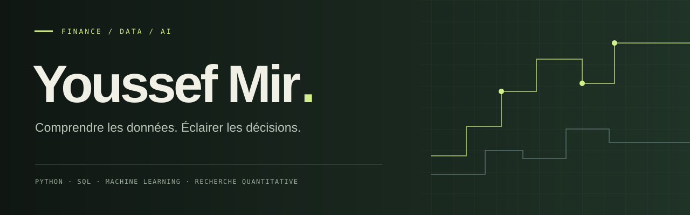

  <a href="https://youssefmir.github.io/">Portfolio</a> &nbsp; / &nbsp;
  <a href="https://www.linkedin.com/in/youssefmir/">LinkedIn</a> &nbsp; / &nbsp;
  <a href="https://github.com/youssefmir?tab=repositories">Tous mes projets</a>

### De la donnée à la décision financière

AI Business Analyst chez **BNP Paribas**, diplômé du **Master MIAGE de l’Université Paris-Saclay**. Je travaille à l’interface du métier et des équipes IT/Data : analyse des besoins, Python, SQL, outils d’IA et reporting.

J’oriente mes projets personnels vers la **finance quantitative** : séries temporelles, stratégies systématiques, mesure du risque et évaluation des modèles. Je m’intéresse autant à ce qu’un modèle permet de conclure qu’aux limites de ses résultats.

(Python) · (SQL) · (Dataiku) · (Power BI) · (scikit-learn) · (TypeScript)

---

### Projets à découvrir

#### 01 — Credit Process Intelligence
**Comprendre où un processus de crédit perd du temps, puis chiffrer les améliorations.**

Analyse de **13 087 demandes de crédit réelles** avec process mining, évaluation prédictive et simulation de Monte Carlo. Le projet relie le diagnostic des données à un business case et aux livrables d’un Business Analyst.

**Finance · Process mining · Python · Machine learning · Monte Carlo**

[Explorer l’étude ↗](https://credit-process-intelligence.vercel.app/) · [Voir le code](https://github.com/youssefmir/credit-process-intelligence)

#### 02 — AI Use Case Factory
**Prioriser des investissements IA en tenant compte de leur valeur, de leur faisabilité et de leurs risques.**

Un atelier interactif pour cadrer des cas d’usage, calculer leur VAN, tester les hypothèses par Monte Carlo et construire une roadmap. **16 cas fictifs dans 3 organisations**, avec des hypothèses et des résultats explicités.

**Business case · Analyse du risque · Monte Carlo · React · TypeScript**

[Ouvrir l’atelier ↗](https://ai-usecase-factory.vercel.app/) · [Voir le code](https://github.com/youssefmir/ai-usecase-factory)

#### 03 — JevGrep · contribution open source
**Trouver du code à partir de ce qu’il fait.**

Contribution au projet de Nassim Arifette, qui utilise **Jev, le modèle de décision de TypeSafe AI**, pour rechercher des extraits de code. Ma contribution porte sur l’ajout d’**OpenRouter** comme fournisseur, aux côtés de TypeSafe et de Vercel AI Gateway.

**TypeSafe Jev · TypeScript · CLI · MCP · OpenRouter**

[Découvrir JevGrep ↗](https://github.com/nassim-arifette/jevgrep)

<strong>Autres travaux — data engineering, modélisation et statistiques</strong>

 

| Projet | Ce que j’y explore | Liens |
| :--- | :--- | :--- |
| **Radar Marchés Publics** | Entrepôt DuckDB/dbt, classement hybride et analyse de la concurrence | [Démo](https://radar-marches-publics.vercel.app/) · [Code](https://github.com/youssefmir/radar-marches-publics) |
| **Prix des billets d’avion** | Prédiction par gradient boosting et simulateur dans le navigateur | [Démo](https://prediction-billets-avion.vercel.app/) · [Code](https://github.com/youssefmir/Prediction-of-the-price-of-airline-tickets-for-an-Indian-company-) |
| **Précipitations au Kerala** | Séries temporelles, tendances et visualisations des précipitations | [Démo](https://precipitations-kerala.vercel.app/) · [Code](https://github.com/youssefmir/Precipitations-dans-le-Kerala) |
| **Pollinisation dans les Pyrénées** | Analyse statistique des changements climatiques et écologiques | [Démo](https://pollination-pyrenees.vercel.app/) · [Code](https://github.com/youssefmir/Analysis-of-pollination-in-the-Pyrenees-main) |

---

### En ce moment

Je développe mes travaux en **recherche quantitative**, avec une attention particulière aux changements de régime, aux coûts de transaction et à la validation temporelle. Mon objectif : des expériences reproductibles, des graphiques lisibles et des conclusions vérifiables.

Pour échanger sur la finance, les données ou l’IA : **[retrouvez-moi sur LinkedIn ↗](https://www.linkedin.com/in/youssefmir/)**.

Projets personnels et contributions open source. Ils ne représentent pas les activités ou positions de mon employeur.
