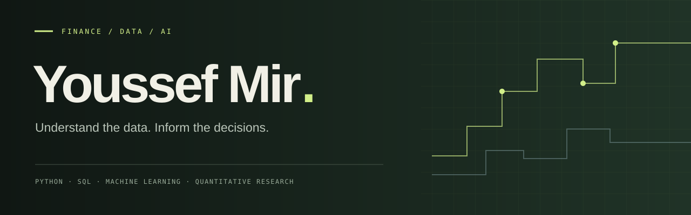
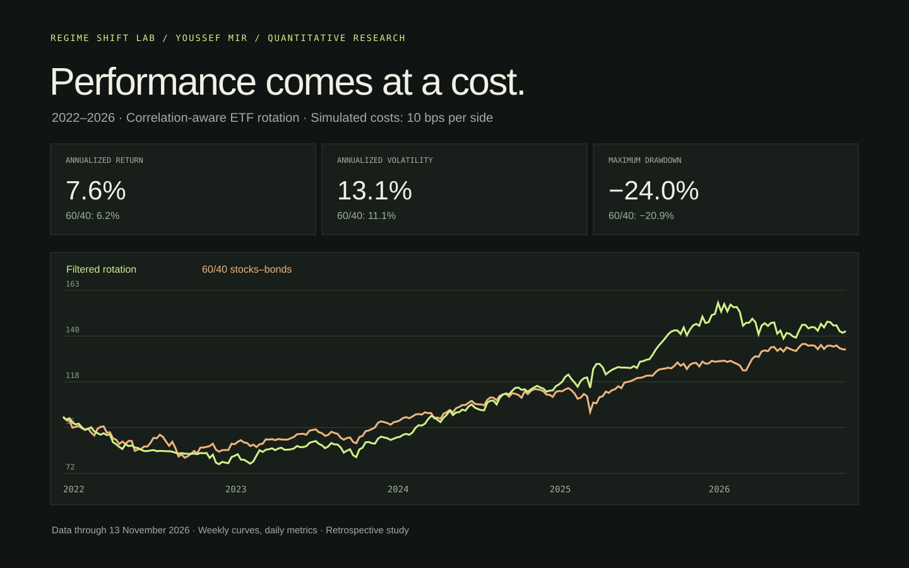
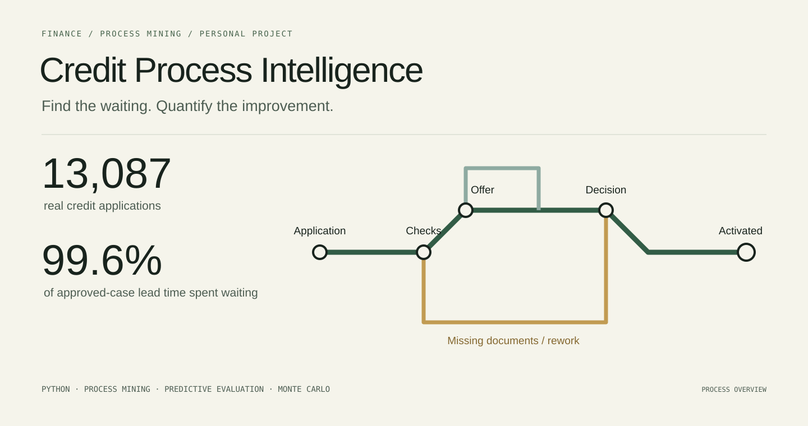
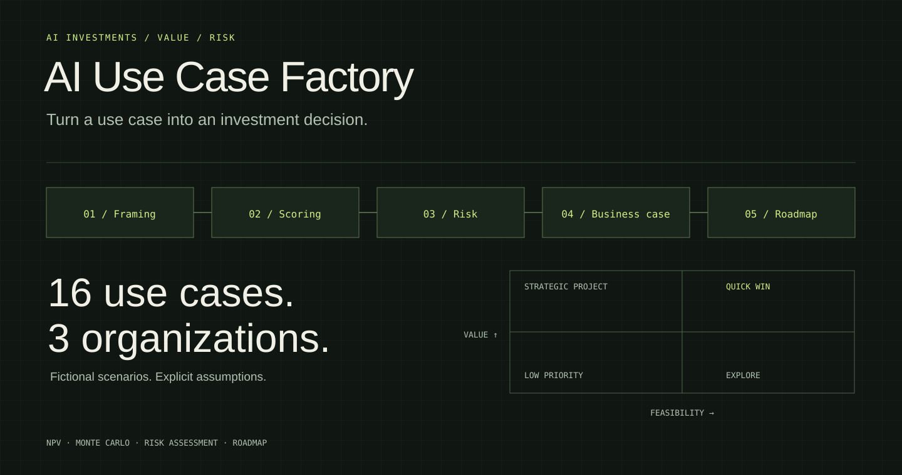

<picture>
  
</picture>

  
  
  
  

<a href="https://github.com/youssefmir?tab=repositories">All my projects</a>

### From data to financial decisions

I work in **Artificial Intelligence Solutions at BNP Paribas** and hold a **Master’s degree in MIAGE from Paris-Saclay University**. My work connects business and IT/Data teams through requirements analysis, Python, SQL, AI tools and reporting.

My personal projects focus on **quantitative finance**: time series, systematic strategies, risk measurement and model evaluation. I am as interested in what a model can tell us as in the limits of its results.

  

---

### Featured projects

#### 01 — Regime Shift Lab
**Testing an ETF rotation strategy when stocks and bonds fall together.**

A reproducible backtest using **SPY, IEF, GLD and SHY**, with momentum, correlation, lagged execution and transaction costs. Over 2022–2026, the simulated annualized return is **7.6%**, compared with **6.2%** for the 60/40 portfolio; the maximum drawdown is also greater (**−24.0%** versus **−20.9%**).

The integration of **Jev from TypeSafe AI** classifies macroeconomic notes into structured probabilities, kept separate from historical signals. The code and tests are published; live model calls require server-side provider activation.

`Quantitative finance` ·  · `ETF` · `Risk analysis` · `TypeSafe Jev`

[Explore the study ↗](https://youssefmir.github.io/research/regime-shift-lab/) · [View the code and methodology](https://github.com/youssefmir/regime-shift-lab)

#### 02 — Credit Process Intelligence
**Finding where a credit process loses time, then quantifying improvements.**

Analysis of **13,087 real credit applications** using process mining, predictive evaluation and Monte Carlo simulation. The project connects data analysis to a business case and Business Analyst deliverables.

`Finance` · `Process mining` ·  · `Machine learning` · `Monte Carlo`

[Explore the study ↗](https://credit-process-intelligence.vercel.app/) &nbsp; · &nbsp; [View the code](https://github.com/youssefmir/credit-process-intelligence)

#### 03 — AI Use Case Factory
**Prioritizing AI investments based on value, feasibility and risk.**

An interactive workshop to scope use cases, calculate their NPV, test assumptions with Monte Carlo simulation and build a roadmap. **16 fictional use cases across 3 organizations**, with explicit assumptions and results.

`Business case` · `Risk analysis` · `Monte Carlo` ·  · 

[Open the workshop ↗](https://ai-usecase-factory.vercel.app/) &nbsp; · &nbsp; [View the code](https://github.com/youssefmir/ai-usecase-factory)

#### 04 — JevGrep · open source contribution
**Finding code by what it does.**

A contribution to Nassim Arifette’s project, which uses **Jev, TypeSafe AI’s decision model**, to search for code snippets. My contribution adds **OpenRouter** as a provider alongside TypeSafe and Vercel AI Gateway.

`TypeSafe Jev` ·  · `CLI` · `MCP` · 

[Discover JevGrep ↗](https://github.com/nassim-arifette/jevgrep)

<strong>More work — data engineering, modeling and statistics</strong>

 

| Project | What I explore | Links |
| :--- | :--- | :--- |
| **Public Procurement Radar** | A DuckDB/dbt warehouse, hybrid ranking and competitive analysis   | [Demo](https://radar-marches-publics.vercel.app/) · [Code](https://github.com/youssefmir/radar-marches-publics) |
| **Airline Ticket Prices** | Gradient boosting predictions and an in-browser simulator | [Demo](https://prediction-billets-avion.vercel.app/) · [Code](https://github.com/youssefmir/Prediction-of-the-price-of-airline-tickets-for-an-Indian-company-) |
| **Rainfall in Kerala** | Time series, trends and rainfall visualizations | [Demo](https://precipitations-kerala.vercel.app/) · [Code](https://github.com/youssefmir/Precipitations-dans-le-Kerala) |
| **Pollination in the Pyrenees** | Statistical analysis of climate and ecological changes | [Demo](https://pollination-pyrenees.vercel.app/) · [Code](https://github.com/youssefmir/Analysis-of-pollination-in-the-Pyrenees-main) |

---

### Currently

I am developing my work in **quantitative research**, with a particular focus on regime changes, transaction costs and temporal validation. My goal is to produce reproducible experiments, readable charts and verifiable conclusions.

To discuss finance, data or AI, **[email me ↗](mailto:miryoussef16@gmail.com)** or find me on **[LinkedIn](https://www.linkedin.com/in/youssefmir/)** and **[X / Twitter](https://x.com/yussefmir)**.

Personal projects and open source contributions. They do not represent my employer’s activities or positions.

